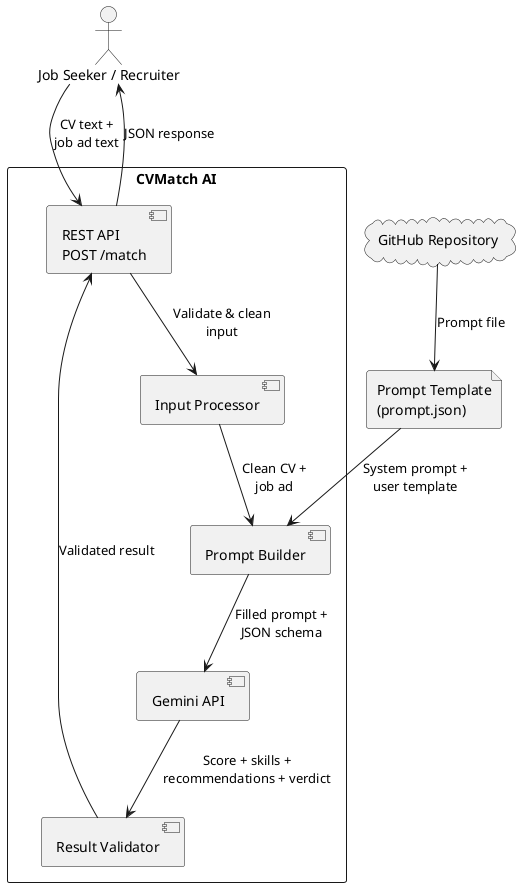
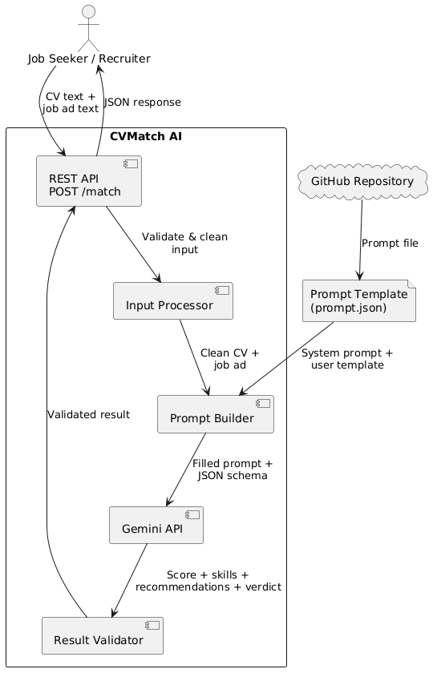
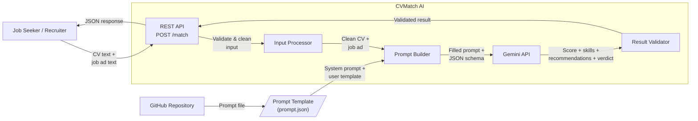
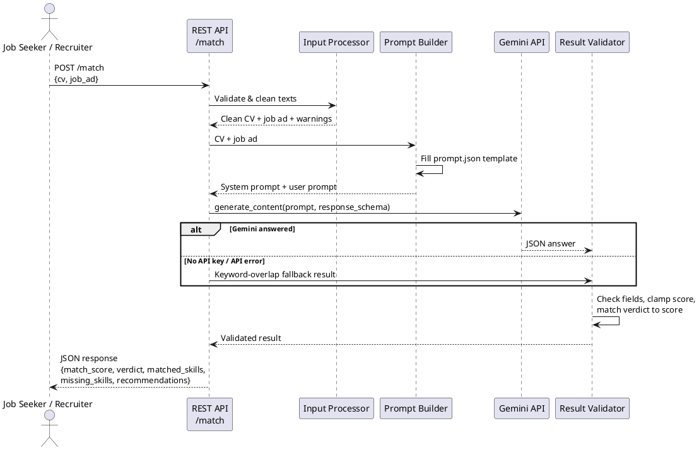
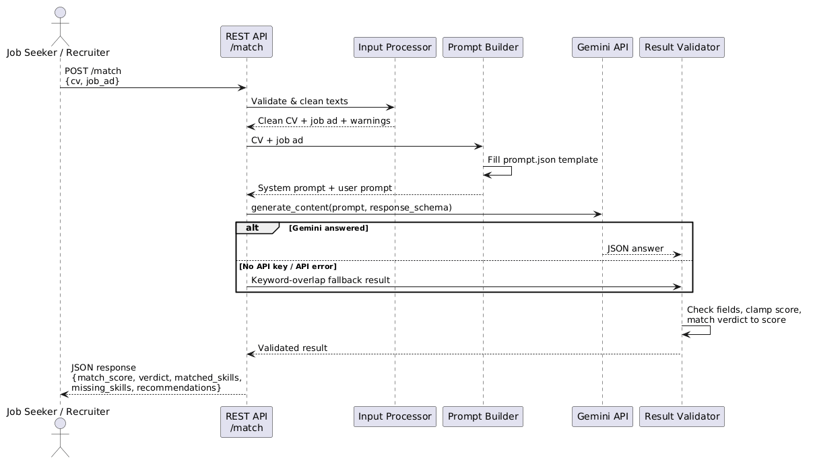
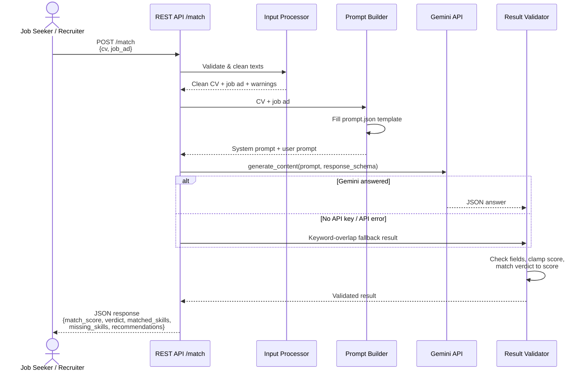

# CVMatch AI — CV and job ad matching with Gemini

**CVMatch AI** is an information system that uses generative AI (Google Gemini API) to evaluate how well a
candidate's CV matches a job advertisement. It returns structured JSON: a match score, a verdict,
matched and missing skills, and concrete recommendations for improving the CV.

| Input `X` | Output `y` |
| --- | --- |
| `cv` — CV text<br>`job_ad` — job advertisement text | `match_score` (0–100), `verdict`, `matched_skills`, `missing_skills`, `recommendations` |

## Repository structure

```
cvmatch/
├── data/
│   ├── examples.json             # (X, y) pairs — 4 end-to-end examples
│   ├── hr_job_change/            # Kaggle HR data for task 1.3
│   ├── documents/                # CV / letter / email / form scans for tasks 1.4–1.5
│   └── photos/                   # workplace photos for task 1.5
├── prompts/
│   └── prompt.json               # test prompt: system prompt + user template (used by Colab and for GPT testing)
├── diagrams/                     # PlantUML (.puml) and Mermaid (.mmd) sources + PNG
├── scripts/prepare_documents_dataset.py   # builds data/documents/ from RVL-CDIP
└── notebooks/
    ├── cvmatch_ai_gemini.ipynb   # Google Colab prototype with the Gemini API
    └── 1_3_… 1_4_… 1_5_…         # TensorFlow tasks 1.3–1.5 (see below)
```

## Data

| File | Description |
| --- | --- |
| [`data/examples.json`](data/examples.json) | 4 `(X, y)` pairs: `{ "id", "scenario", "X": { "cv", "job_ad" }, "y": { ... } }` |

The examples cover different cases:

| Example | Scenario | `y.match_score` | `y.verdict` |
| --- | --- | --- | --- |
| `example_01` | Python developer → Python backend role | 85 | Strong match |
| `example_02` | Junior Java developer → full-stack role | 52 | Partial match |
| `example_03` | Accountant → DevOps engineer role | 5 | No match |
| `example_04` | Very short CV → junior QA tester role | 30 | Weak match |

All people and companies in the examples are fictional.

## Prompts

- [`prompts/prompt.json`](prompts/prompt.json) — the test prompt. `system_prompt` sets the recruiter role and scoring
  rules, `user_prompt_template` holds the CV and job ad (`{{cv}}`, `{{job_ad}}`) and the JSON structure to return.
  Give it to a GPT agent with `X` from any example and it answers in the `y` format; the Colab notebook sends the
  same prompt to the Gemini API.

## UMLs

### PlantUML Component diagram





### Mermaid Component diagram



### PlantUML Sequence diagram





### Mermaid Sequence diagram



## Google Colab demo

[](https://colab.research.google.com/github/jauniusc/cvmatch/blob/main/notebooks/cvmatch_ai_gemini.ipynb)

The working prototype is [`notebooks/cvmatch_ai_gemini.ipynb`](notebooks/cvmatch_ai_gemini.ipynb). It walks through the
same steps as the sequence diagram: it loads `prompt.json` and `examples.json` from this repository, cleans the CV and
the job ad, fills in the prompt, asks Gemini for a JSON answer and checks that answer. The function
`post_match(cv, job_ad)` joins these steps together, just like the `POST /match` endpoint would.

In the last part every example is sent through the pipeline and the answer is compared with the expected `y`:

- the score difference for each example and the average error;
- whether the verdict is the same;
- a bar chart and a short report for each CV.

There is also a cell where you can paste your own CV and job ad.

**Running it**

1. Create an API key in [Google AI Studio](https://aistudio.google.com/apikey).
2. In Colab open 🔑 Secrets, add `GEMINI_API_KEY` and allow notebook access.
3. Choose Runtime → Run all.

If no key is set, Gemini is not called and a basic keyword comparison fills in the answer instead, so every cell still
runs, but the results are much less accurate.

## Lab 1, tasks 1.3–1.5: TensorFlow

Each notebook first explains how the lecturer's Colab notebook works, then redoes it with my own data and ends with conclusions.

| Task | Notebook | My data | Result |
|---|---|---|---|
| 1.3 | [`1_3_hr_job_change_nn.ipynb`](notebooks/1_3_hr_job_change_nn.ipynb) [](https://colab.research.google.com/github/jauniusc/cvmatch/blob/main/notebooks/1_3_hr_job_change_nn.ipynb) | [Kaggle HR: is the candidate looking for a new job?](data/hr_job_change/) | accuracy 0.765, AUC 0.794 |
| 1.3 | [`1_3_hr_job_change_decision_forests.ipynb`](notebooks/1_3_hr_job_change_decision_forests.ipynb) [](https://colab.research.google.com/github/jauniusc/cvmatch/blob/main/notebooks/1_3_hr_job_change_decision_forests.ipynb) | same | Random Forest: accuracy 0.792, AUC 0.803 |
| 1.4 | [`1_4_documents_cnn.ipynb`](notebooks/1_4_documents_cnn.ipynb) [](https://colab.research.google.com/github/jauniusc/cvmatch/blob/main/notebooks/1_4_documents_cnn.ipynb) | [scanned CVs, letters, emails, forms](data/documents/) | CNN 0.813, MLP 0.25 |
| 1.5 | [`1_5_one_image_workplace.ipynb`](notebooks/1_5_one_image_workplace.ipynb) [](https://colab.research.google.com/github/jauniusc/cvmatch/blob/main/notebooks/1_5_one_image_workplace.ipynb) | [workplace photos](data/photos/) + a CV scan | pretrained models, no training |
| 1.5 | [`1_5_transfer_learning_documents.ipynb`](notebooks/1_5_transfer_learning_documents.ipynb) [](https://colab.research.google.com/github/jauniusc/cvmatch/blob/main/notebooks/1_5_transfer_learning_documents.ipynb) | scanned documents | 0.855 (CNN from zero: 0.813) |

To run a notebook: open it in Colab → Runtime → Run all (no API key needed). The data is read from this repository.
The Decision Forests notebook uses YDF, because `tensorflow_decision_forests` no longer installs in Colab.
